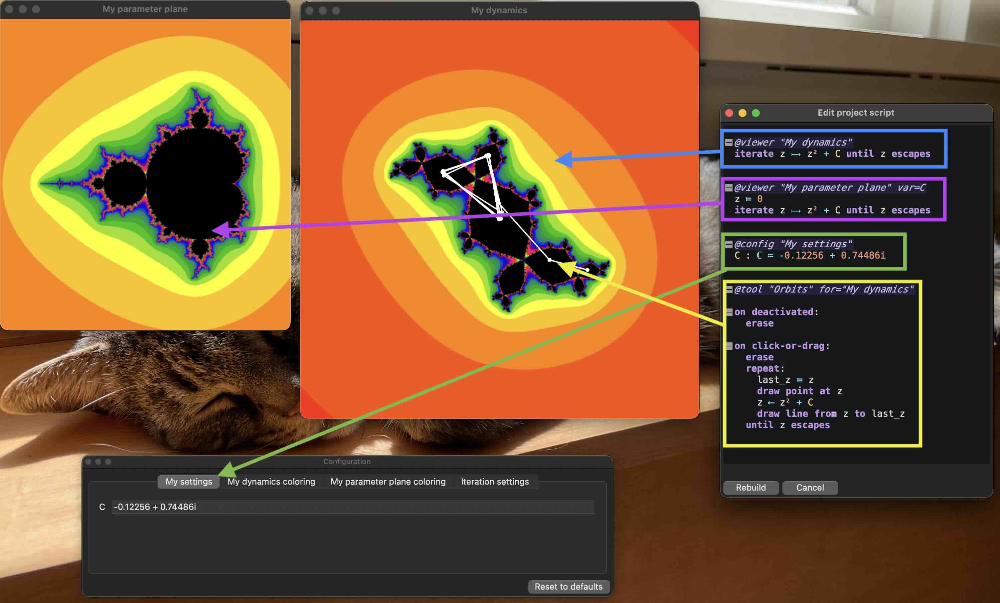

# FractalStream
An updated version of FractalStream (http://www.math.cornell.edu/~noonan/fstream.html),
a tool to assist research in real and complex dynamical systems.

# Installation

## MacOS

There are two ways to get FractalStream on a Mac:

### via GitHub releases
For modern Macs, download [FractalStream v0.0.5 for MacOS](https://github.com/matt-noonan/FractalStream/releases/download/v0.0.5-alpha/FractalStream-0.0.5-alpha-macos-arm64.zip).
Older Intel-based Macs should download [FractalStream v0.0.5 for Intel Macs](https://github.com/matt-noonan/FractalStream/releases/download/v0.0.5-alpha/FractalStream-0.0.5-alpha-macos-x86_64.zip).

### via `homebrew`
Instead of downloading the app directly, you can also install FractalStream via Homebrew.
Install [Homebrew](https://brew.sh), open `Terminal.app`, and run these commands:
``` shell
brew tap matt-noonan/fractalstream
brew trust matt-noonan/fractalstream
brew install --cask fractalstream
```

## Linux

For Linux, download [the FractalStream v0.0.5 AppImage for Linux](https://github.com/matt-noonan/FractalStream/releases/download/v0.0.5-alpha/FractalStream-0.0.5-alpha-linux-x86_64.AppImage).

## Windows

For Windows, download [the FractalStream v0.0.5 Windows installer](https://github.com/matt-noonan/FractalStream/releases/download/v0.0.5-alpha/FractalStream-0.0.5-alpha-windows-x86_64-setup.exe).

# Getting started

## Parts of a FractalStream script

A FractalStream script defines one or more *viewers* (optionally equipped with *tools*),
and optionally a number of *configuration variables*.

