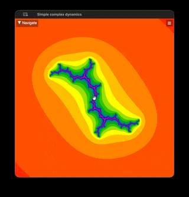
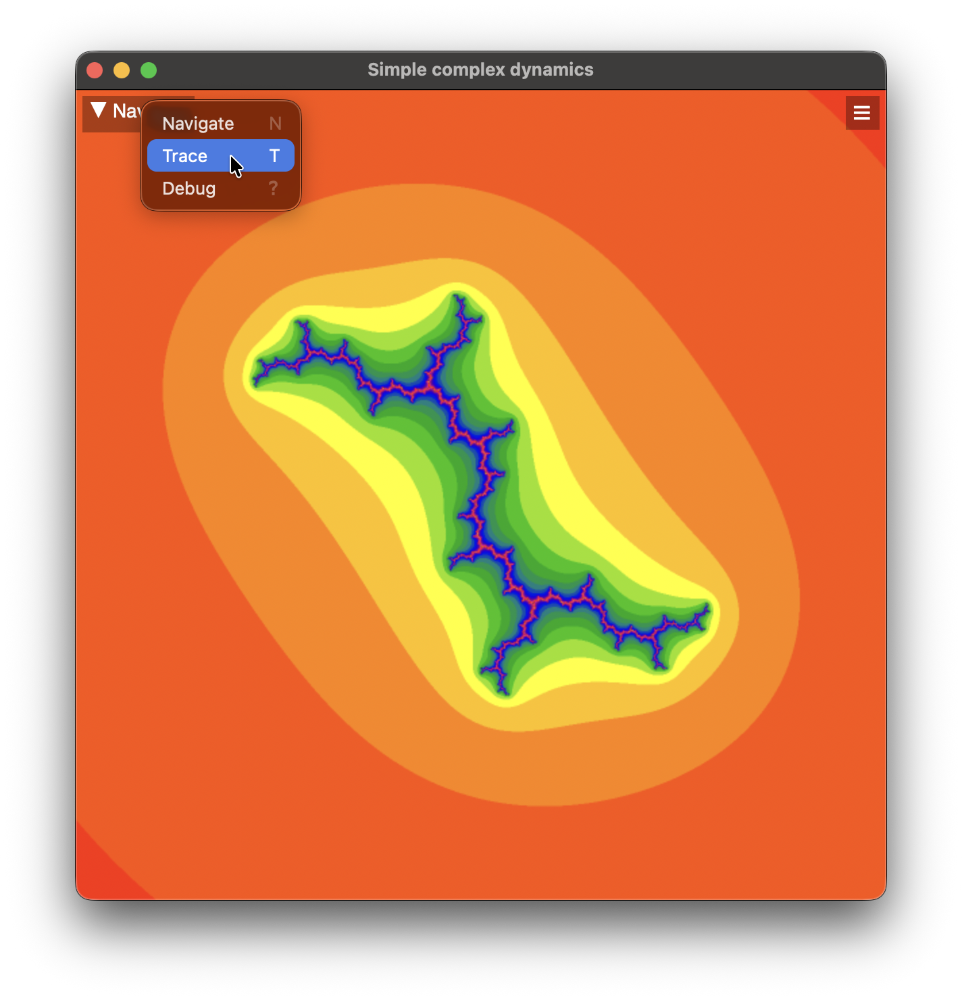
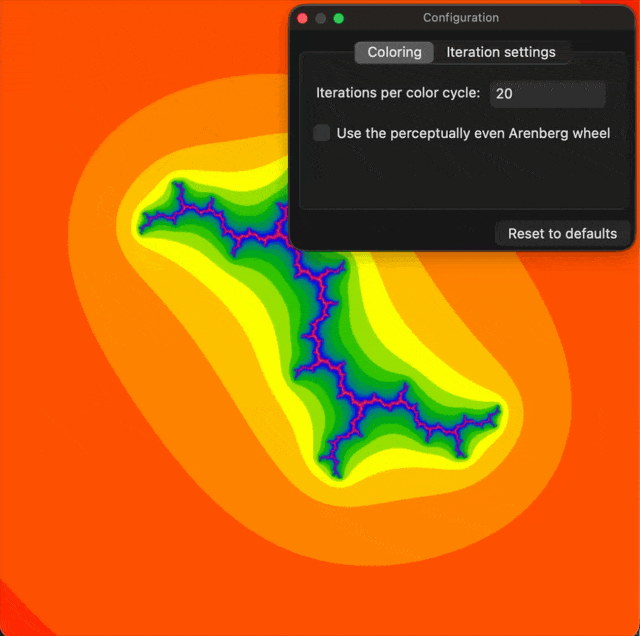

# Using FractalStream

## The script library

When you start FractalStream, the first thing you will see is the *script library*. This
is a curated collection of scripts that come pre-packaged with FractalStream, plus a
quick link to your own local folder of scripts.

Open any one of the sample scripts to get started, or choose `New project...` to write a
script based on a pre-existing outline.

## Navigation in a viewer window

Within a viewer, you can navigate as if the view were a map: drag to recenter, and pinch or
scroll to zoom in and out. You can navigate back and forth through your history with `<` and
`>`, return to the initial view with `^`, or jump to a new view with `@`.

The `@` key opens a dialog showing the current view, which you can edit to jump somewhere else.
What it shows depends on the kind of viewer: on the plane, the point in the middle and the size
of a pixel; on the Riemann sphere, the point the globe faces (`∞` for the point at infinity), how
far the globe is turned about that point, and the size of a pixel in the middle; in the
hyperbolic plane, the point in the middle, how far the picture is turned about it, and the size
of a pixel.

A viewer of the Riemann sphere shows it as a globe that always fills the window. Drag to turn the
globe, and scroll or pinch to zoom in or out around the point under the pointer. Zoomed in, the
area you are looking at is magnified and the rest of the sphere is squeezed towards the rim, so a
drag pans across it; zoomed out, you can see more than half of the sphere at once.

If your viewer offers additional tools, you will find them in the tool menu on the upper
left corner of your viewer

Other options are found in the hamburger menu on the upper right

## Changing configuration values

To change the values of configuration variables, select `Show configuration` from the
hamburger menu, or press `=` (desktop app only). Changes made to the configuration
variables are immediately reflected in the viewers.

## Using tools

**TODO**
