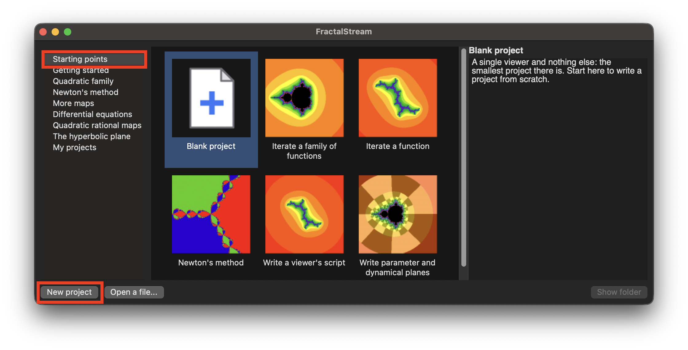
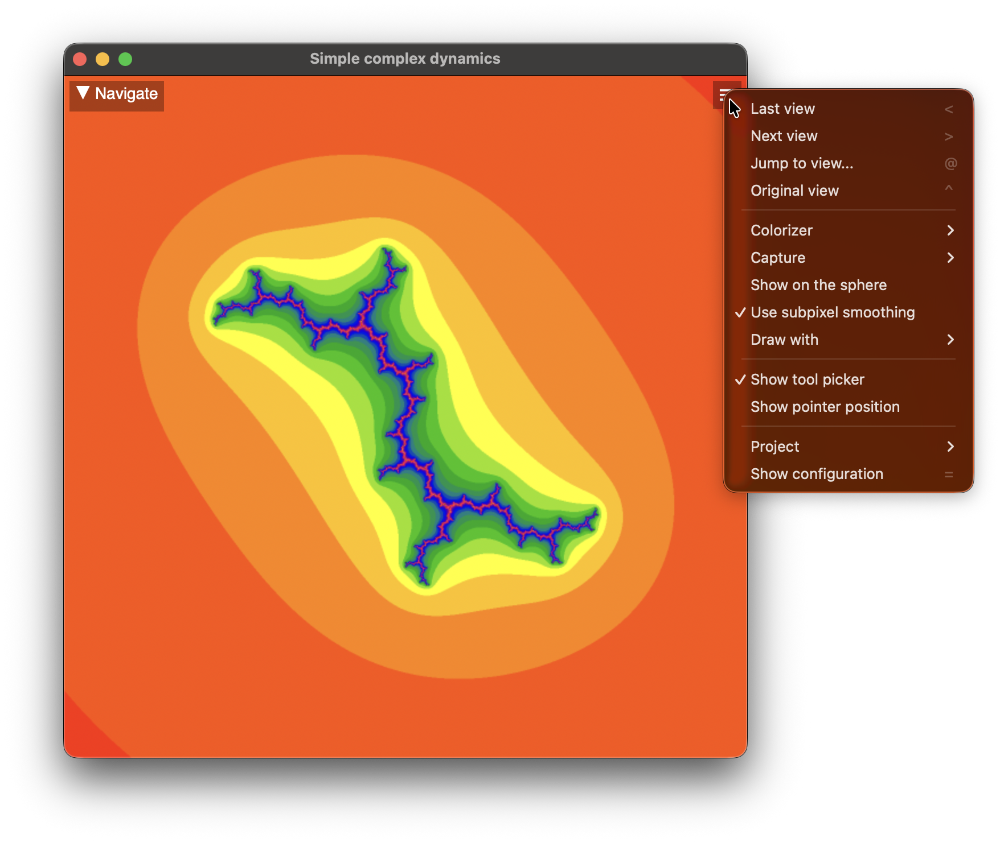

# Using FractalStream

## The script library

When you start FractalStream, the first thing you will see is the *script library*. This
is a curated collection of scripts that come pre-packaged with FractalStream, plus a
quick link to your own local folder of scripts.

Open any one of the sample scripts to get started, or choose `New project...` to write a
script based on a pre-existing outline.

## Navigation in a viewer window

Within a viewer, you can navigate as if the view were a map: drag to recenter, and pinch or
scroll to zoom in and out. You can navigate back and forth through your history with `<` and
`>`, return to the initial view with `^`, or jump to a new view with `@`.

If your viewer offers additional tools, you will find them in the tool menu on the upper
left corner of your viewer

Other options are found in the hamburger menu on the upper right

## Changing configuration values

To change the values of configuration variables, select `Show configuration` from the
hamburger menu, or press `=` (desktop app only). Changes made to the configuration
variables are immediately reflected in the viewers.

## Using tools

**TODO**
