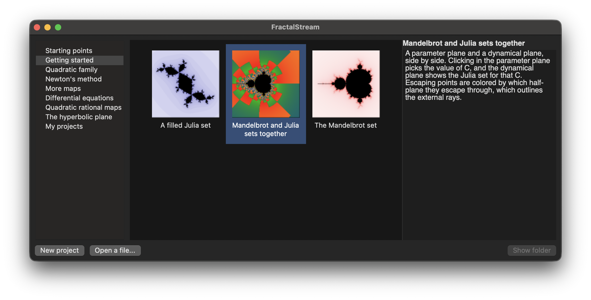
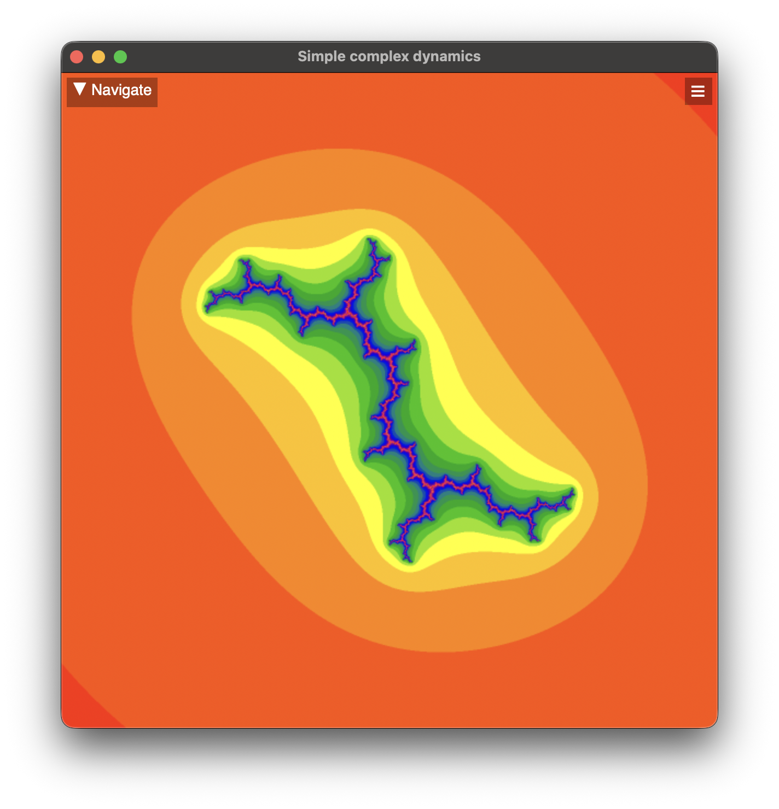

# Using FractalStream

## The script library

When you start FractalStream, the first thing you will see is the *script library*. This
is a curated collection of scripts that come pre-packaged with FractalStream, plus a
quick link to your own local folder of scripts.



Open any one of the sample scripts to get started, or choose `New project...` to write a
script based on a pre-existing outline.


## Navigation in a viewer window

Within a viewer, you can navigate as if the view were a map: drag to recenter, and pinch or
scroll to zoom in and out. You can navigate back and forth through your history with `<` and
`>`, return to the initial view with `^`, or jump to a new view with `@`.



If your viewer offers additional tools, you will find them in the tool menu on the upper
left corner of your viewer


Other options are found in the hamburger menu on the upper right


## Changing configuration values

To change the values of configuration variables, select `Show configuration` from the
hamburger menu, or press `=` (desktop app only). Changes made to the configuration
variables are immediately reflected in the viewers.

**TODO**

(table-files)=
## Saving, exporting, and importing tables

Some projects keep data in *tables* (see {ref}`language-tables`), which tools fill in and
viewers read. Each table has a line of its own in the configuration panel, showing its name,
its type, and its current size.

### Saving a project with its tables

A table can hold a lot of data, so saving it is up to you. When you save a project while any of
its tables holds something, FractalStream asks whether to save the tables along with it, and
says how big they are:

- **Save with tables** saves the project as a `.fsz` file: a zip archive holding the project and
  its tables' data. When you open the project again, its tables are filled in just as they were,
  as long as the script still declares each one with the same name and type.
- **Save without tables** saves the project as a plain `.fs` file, and its tables start out
  empty the next time you open it.

Later saves keep your answer, so you're only asked again when you choose `Save project as`.

### Exporting a table

To save one table's contents in a file of its own, use the **Export** button on its line in
the configuration panel. A table can be exported in two forms:

- **As a table (`.zip`)**: a zip file holding two files, the table's elements and a short
  description of them (its type, its size, and its position in the plane). This is exactly how
  a `.fsz` project file stores the table, and it can hold any table.
- **As CSV (`.csv`)**, for use in other programs: available for tables of one or two dimensions
  holding real numbers, integers, truth values, or complex numbers. A 1-dimensional table is
  written with one value on each line. A 2-dimensional table of size `(w, h)` is written as `h`
  lines of `w` values each, so that each line is one row of the table. A complex number is
  written as two values (its real part, then its imaginary part), and truth values are written
  as `0` and `1`.

On the desktop, the file dialog lets you choose between the two forms; in the browser, CSV has
a button of its own, **Export CSV**.

For example, Python's `numpy` can read a 2-dimensional table of complex numbers exported as CSV
like this:

``` python
import numpy as np
values = np.loadtxt("T-table.csv", delimiter=",", ndmin=2)
table = values[:, 0::2] + 1j * values[:, 1::2]   # table[k - 1, j - 1] is T @ (j, k)
```

### Importing a table

The **Import** button replaces a table's contents with a file's, and every viewer that reads
the table is drawn again:

- **A table exported from FractalStream (`.zip`)** can be imported into any table of the same
  type, in this project or another one. The table takes on everything from the file: its size,
  its position in the plane, and its contents.
- **A CSV file** can be imported into a table that can be exported as CSV (see above). The
  table's size comes from the shape of the CSV, and the table keeps its current position in the
  plane, since a CSV file doesn't record one. Values can be written as other programs write
  them, such as `.5`, `1e-3`, `inf`, or `nan`.

If a file can't be imported (it holds a table of another type, say, or a value in a CSV can't be
read), FractalStream says what's wrong, and the table is left as it was.

## Using tools

**TODO**
